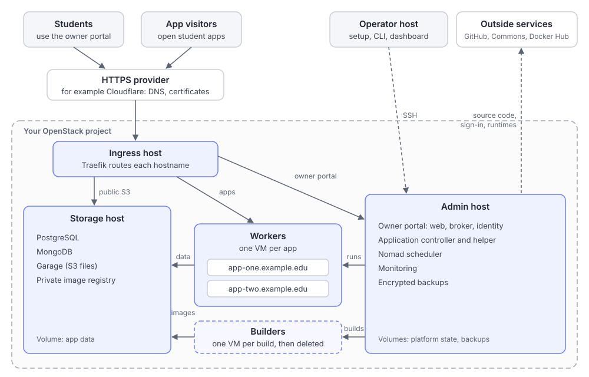

# OpenStack app platform for classes

This repository runs **6.1040 Apps**, a platform for hosting students' web apps inside a course's OpenStack project. Students use a website called the **owner portal**; course operators deploy and maintain the platform.

Students sign in, connect a GitHub repository, and deploy an exact commit. The platform builds each app and runs it on a dedicated virtual machine (VM), at `<app-name>.<domain>`. Each app can also have PostgreSQL, MongoDB, and S3 file storage on a separate storage host.

The deployment configuration chooses the class domain, OpenStack project, machine sizes, and sign-in provider.

## Who it's for

- **Course staff** in project-based classes who want every student or team to deploy a web app without giving students cloud credentials.
- **Schools and labs that already run OpenStack** and want a managed way to host many small apps on it.
- **Students** in a class that uses it: start with [Deploy an app](docs/guides/for-app-owners.md).
- **Contributors and readers studying hosting platforms**: start with [How it works](docs/how-it-works.md) for the architecture and request paths.

You need an OpenStack project. Apps must use Node.js or Bun and a committed lockfile. The platform uses a generated build recipe and named package scripts; it does not accept Dockerfiles, arbitrary build commands, custom domains, or multiple serving instances per app.

## The five machine roles

A **role** describes a kind of machine, not a person's permissions. All five roles run NixOS, with configurations built from this repository.

| Machine role | Lifetime | Job |
| --- | --- | --- |
| **Admin** | Persistent host | Runs the controller, portal, Nomad scheduler, monitoring, and backups |
| **Ingress** | Persistent host | Runs Traefik, which routes incoming requests by hostname |
| **Storage** | Persistent host | Runs per-app database servers, shared S3 storage, and the private app image registry |
| **Worker** | Disposable; dedicated to one app | Runs the app container; local disk is lost on replacement |
| **Builder** | Disposable; one per build | Builds and publishes one app image, then is deleted |

App traffic follows browser → Cloudflare (or your HTTPS provider) → ingress → worker. The app connects to its database on the storage host over the private network. [How it works](docs/how-it-works.md) explains this path and the separate management path.

## What it does

For **students** (app owners), the owner portal lets them:

- deploy an exact commit from a public or private GitHub repository, with a supported Node.js or Bun version requested by the repository;
- see build output, logs, deployment history, and health, and roll back to an earlier commit;
- add PostgreSQL, MongoDB, or S3 file storage, and set environment variables whose saved values cannot be read back through settings;
- share an app with teammates.

For **course staff**, the platform provides:

- a setup tool that builds and boot-tests every machine image from one Git commit, then creates the whole deployment in your OpenStack project;
- roles for students, staff who manage apps across the class, and portal admins who also delete entire apps and manage accounts, quotas, and the audit log, with sign-in through Commons (the class site) or local accounts;
- separate encrypted backups for platform state, portal state, and app data, with restore tools and optional export to a mounted off-site filesystem;
- an operator command-line tool for health, host replacement, upgrades, and recovery, plus a read-only health dashboard.

## Start here

| If you want to… | Read |
| --- | --- |
| Understand what this is and how it works | [How it works](docs/how-it-works.md) |
| Decide whether you can run it for your class | [Plan a deployment](docs/guides/plan-a-deployment.md) |
| Set it up | [Deploy the platform](docs/guides/deploy-the-platform.md), then [Open the owner portal](docs/guides/open-the-portal.md) |
| Run it day to day as an operator | [Run the platform](docs/guides/run-the-platform.md) |
| Manage apps as staff, or accounts and quotas as a portal admin | [Manage apps and people](docs/guides/manage-apps-and-people.md) |
| Deploy an app as a student | [Deploy an app](docs/guides/for-app-owners.md) |
| Change the code | [Development](docs/development.md) |

The [documentation home](docs/README.md) lists every guide and reference page, and has a glossary.

## What you need

- An OpenStack project with room for three persistent hosts, dedicated app workers, short-lived builders, and three persistent volumes: admin state, backups, and app data. Staged replacement can temporarily need a second worker for an app. Size the volumes for your class; [the example inventory](config/platform.example.json) is not a capacity recommendation.
- A domain, with HTTPS in front of the platform from a provider such as Cloudflare.
- An x86_64 Linux machine where an unprivileged account runs the setup and operator tools, with Nix, uv, and Python 3.14.

[Plan a deployment](docs/guides/plan-a-deployment.md) covers the details.

## Repository layout

| Directory | What's in it |
| --- | --- |
| `openstack_platform/` | The Python code: setup, the operator CLI, the application controller and its helper, and the owner portal services |
| `frontend/` | The owner portal and operator dashboard (React and TypeScript) |
| `nix/` | NixOS configurations for the five machine roles, and image builds |
| `infra/` | Scripts that setup and the machines run (OpenStack calls, backups, certificates, registry, monitoring) and the shared platform contract |
| `deploy/` | Scripts that install operator and helper releases |
| `config/` | Example configuration |
| `tests/` | The test suite |
| `docs/` | This documentation |

The [repository map](docs/reference/repository-map.md) describes every file.

## License

Licensed under the [Apache License 2.0](LICENSE).
