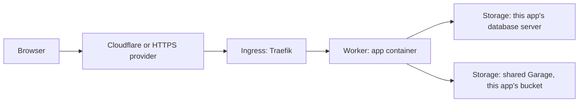
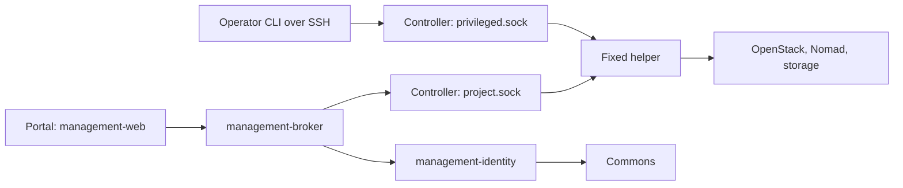

# How it works

This page explains where apps run, how requests reach them, and how the portal controls deployments. Read it before operating or changing the platform. It assumes you know what a server, container, and database are; other terms are in the [glossary](README.md#glossary).

## The big picture

**6.1040 Apps** hosts student apps inside one OpenStack project. OpenStack provides the virtual machines (VMs), private network, and persistent disk volumes. Students manage apps through the **owner portal**, usually called the portal in these docs.

The platform uses five machine **roles**:

| Role | Lifetime and number | Job |
| --- | --- | --- |
| **Admin** | One persistent host | Runs the controller, portal, Nomad scheduler, monitoring, and backups |
| **Ingress** | One persistent host | Runs Traefik, the reverse proxy that routes requests by hostname |
| **Storage** | One persistent host | Runs per-app PostgreSQL and MongoDB servers, shared Garage S3 storage, and the private app image registry |
| **Worker** | Disposable; dedicated to one app | Runs the app container. A staged replacement can temporarily have old and new workers. |
| **Builder** | Disposable; one per build | Builds and publishes one app image, then is deleted |

Every role runs NixOS. Its operating-system configuration is built into a VM image from this repository. Updating a host's OS means replacing the VM with one booted from a new image. Controller/helper and portal releases also have their own installation paths; see [Releases and upgrades](guides/releases-and-upgrades.md).

The three persistent hosts can also be replaced. Their attached data volumes survive replacement. Workers have no persistent volume or SSH access. An ordinary redeploy replaces the worker; an operator can explicitly reuse a verified worker during maintenance. Resizing and OS upgrades require replacement. An app must treat all worker-local files as disposable.

Two components sit outside the project:

- **Cloudflare or another HTTPS provider** accepts public browser traffic and forwards it to ingress. In Cloudflare Tunnel mode, `cloudflared` on ingress connects outward, so no public web port is needed on the host.
- **The operator host** is the external x86_64 Linux machine where an unprivileged account runs setup and the `openstack-platform` CLI. Its generated SSH configuration pins the admin host's key.

## Addresses

With a configured domain of `example.edu`:

| Address | Service |
| --- | --- |
| `https://example.edu` | The portal |
| `https://<app-name>.example.edu` | An app, using its chosen name (slug) |
| `https://s3.example.edu` | The public S3 API, including signed upload and download links |

The public S3 hostname is `s3.<domain>`; its private storage endpoint is separate.

## What happens when someone visits an app

1. The browser opens `https://<app-name>.example.edu`. Cloudflare accepts the HTTPS connection.
2. Cloudflare forwards the request to ingress, preserving the hostname. Tunnel mode delivers it to local Traefik; direct mode accepts traffic only from the configured provider ranges.
3. Traefik uses the app's hostname and Nomad service registration to forward the request to its worker.
4. The app handles the request. When it needs a database, it connects over the private network to that app's PostgreSQL or MongoDB server on storage. File operations use its bucket in Garage.
5. The response returns through ingress and Cloudflare to the browser.

The database connection is made by the app, not the browser or ingress. Each database instance has a network allowlist for its app's worker IPs, plus fixed administration addresses. Each app gets only its own database and bucket credentials. Public signed S3 links take a separate route from ingress directly to Garage.

Workers accept app traffic only from ingress under the OpenStack security-group rules. Worker and builder workloads are blocked from the cloud metadata service. [Security](security.md) explains these boundaries.

## What happens when a student deploys

The student signs in to the portal, creates an app, and chooses a GitHub repository, runtime, package scripts, port, health-check path, and exact commit. The broker checks the student's permissions before forwarding the request to the controller.

1. The **controller** checks the request's types and values. It requires a canonical GitHub URL and an exact commit. It rejects unknown fields and caller-supplied shell commands.
2. The controller asks its **helper** to fetch that commit and prepare a generated build recipe. The helper selects a supported official Node.js or Bun image for the version requested by the repository.
3. A fresh **builder** installs packages from the committed lockfile and runs the configured package build script, if present. Repository Dockerfiles are ignored. Package scripts still execute the app's untrusted code.
4. The builder packages the app into a container image and pushes it to the private registry on storage. The builder is then deleted.
5. The platform creates a dedicated **worker**, or reuses the accepted worker if the operator explicitly requested that maintenance path. **Nomad**, the scheduler, starts the app container with its environment variables and storage credentials.
6. A staged deployment first serves a preview route. Nomad, app, and public route checks must pass before the new version is accepted. After promoting the public route, the controller checks it again. The public response must carry the expected `X-Platform-Deployment` marker, so an unrelated HTTP success is insufficient.
7. After acceptance, the old version and any replaced worker are removed. A failed ordinary deployment preserves the previous accepted version. Maintenance stops the old version before cutover, so failure can leave the app stopped.

On a fresh worker, the platform measures available CPU and memory and reserves capacity for the OS and services. The app's memory allocation leaves another 32 MiB and rounds down to 128 MiB, with a 64 MiB minimum. Memory is a hard container limit. CPU is half the measured budget, rounded down to 100 MHz with a 100 MHz minimum. Nomad treats CPU as a soft share: the app can use all the worker's vCPUs. The portal describes the available memory and vCPU count.

The controller records each operation's progress. After an interruption, it checks provider and scheduler evidence before continuing. Ambiguous cleanup stops in **recovery required**. See [Choose a deployment path](guides/deploy-apps-from-the-command-line.md#choose-a-deployment-path) for maintenance, worker reuse, and rollback behavior.

## Where data lives

Each app can have one PostgreSQL database, one MongoDB database, and one S3 bucket. They live on the storage host's data volume, so replacing a worker does not remove them. The app chooses which environment variable names receive each connection detail.

### Database servers and limits

Each PostgreSQL or MongoDB resource runs as its **own database server**, in a Podman container managed by a `<namespace>-database@<id>` systemd unit. New resources use this instance design. Sealed copies on the shared servers remain as migration fallbacks; [Migrate storage instances](guides/migrate-storage-instances.md) describes that migration.

Each instance has CPU (`CPUQuota`), memory (`MemoryMax`, with no swap), connection, and disk caps. An XFS project quota limits the database files to 150% of the logical size limit, rounded up to a MiB, leaving room for database overhead. These limits bound each instance's resource use. The instances still share one host and data volume; a host or volume failure affects them all.

| Resource | Limit behavior |
| --- | --- |
| **PostgreSQL** | Logical size is reported; the filesystem quota caps physical files. `max_connections` is the app connection limit plus five reserved administrator connections. |
| **MongoDB** | Usage above the logical data-and-index size limit blocks writes; reads and deletes remain available. Writes resume at 95% of the limit or less. The server accepts the connection limit plus ten; the app URI sets `maxPoolSize` to the connection limit. |
| **S3** | All buckets share one Garage service. Each app has its own bucket, a key limited to that bucket, and byte and object quotas. |

Changing database memory or connection limits restarts that instance. A shared resource must be migrated before its connection cap can be raised. Portal admins edit resource limits; staff can delete storage but cannot edit these limits.

The app's Settings page shows cached usage. The controller collects it every five minutes, or every minute at 80% of the size limit, while MongoDB writes are blocked, or after a failed measurement. A sampled logical-size limit is not an instantaneous physical disk cap.

### Secrets and backups

Environment values and database credentials live in encrypted **Nomad Variables** scoped to an app. The controller records their names, and the portal/API do not return saved values. App code can read its injected values. Private repository deploy keys are stored separately on admin.

Admin writes separate encrypted backup sets for controller state and deploy keys, portal state, and managed app data to its backup volume. Operator state is backed up on the operator host. Managed-data backups run nightly at 03:15 UTC with up to 30 minutes of delay; retention is 14 days, keeping at least the newest three sets.

App images in the registry and Nomad Variable values are not backed up. After full loss, rebuild images from Git and restore secrets from escrow. Off-site export requires a mounted filesystem on admin, re-mounted after admin replacement. As of 2026-10-10, export is not configured in the live deployment, so its `offsite_recovery` health check fails there. [Backups and recovery](guides/backups-and-recovery.md) gives the setup and restore procedures.

Deleting an entire app removes its worker, database instances and data, S3 bucket and objects, environment variables, deploy key, and memberships. The portal allows only admins to do this, after recent re-authentication and exact-slug confirmation. Recovery requires platform backups and separately escrowed secrets; deletion has no undo button.

## Signing in

The portal supports two account sources:

- **Commons class accounts.** Commons is a separate class website. It asks the student to approve sign-in and returns a single-use code. The identity service exchanges that code for an identity, server to server. The portal never sees the Commons password.
- **Local accounts.** The broker stores hashed passwords. Portal admins must be local and use a time-based one-time password (**TOTP**) from an authenticator app.

Account roles control portal permissions. They do not grant an operator shell or choose a machine role.

| Account role | Permissions |
| --- | --- |
| **Owner** | Create apps within their quota, manage their own apps and apps they belong to, and add teammates |
| **Staff** | View and manage all apps, create for an owner, adopt or reassign apps, delete storage, and deploy with maintenance or resizing; no app-count limit |
| **Portal admin** | Staff permissions plus whole-app deletion, storage-limit editing, account/role/quota administration, and the audit log |

See [Open the owner portal](guides/open-the-portal.md) for sign-in setup and [Manage apps and people](guides/manage-apps-and-people.md) for permissions.

## How the pieces talk to each other

Management requests follow a separate path from app traffic:

`management-web` serves pages and forwards portal API calls to the broker. It has no access to the controller sockets or broker database. The broker owns authorization, sessions, ownership, quotas, and the audit log. It has no network access; it calls the controller and identity service through local Unix sockets. Only the identity service redeems codes with Commons.

The controller has two local sockets, with no network listener:

| Socket | Allowed caller in the hosted configuration | Purpose |
| --- | --- | --- |
| **Project** (`project.sock`) | Broker's exact user/group IDs | App operations on behalf of portal users |
| **Privileged** (`privileged.sock`) | Operator account's exact user/group IDs | Platform-wide administration through `/v1/admin/...` routes |

Linux checks the connecting process's identity with `SO_PEERCRED` before the controller reads a request. The broker cannot connect to the privileged socket. A portal admin still uses the broker and project socket; the account role does not grant privileged-socket access.

**App deletion is available on both sockets.** The broker's `POST /v1/apps/{app}/delete` checks the portal admin role, recent re-authentication, and exact app slug, then calls the project route `POST /v1/applications/{id}/delete`. The operator can use the same controller deletion route on the privileged socket. Other privileged routes use the `/v1/admin/` prefix. [Controller API](reference/controller-api.md) lists the exact route sets.

The controller calls a fixed helper for cloud, scheduler, and storage changes. The helper accepts only allowlisted actions and obtains the credentials those actions need. [Security](security.md) describes the trust boundaries; [Internals](reference/internals.md) describes their implementation.

## How the platform is built and updated

A release ties source and built artifacts together with signed evidence. The image pipeline builds all five roles and runs their VM checks before publication. Image selection uses exact OpenStack IDs. A real host must pass role-specific live checks before its image is accepted.

Persistent-host replacement stops the old host while its network port and data volumes move to the new VM. The old VM is retained for rollback until checks pass. The outage affects that host's services: replacing admin briefly interrupts the portal/controller while already-running apps continue serving. Ingress or storage replacement interrupts their traffic or data services.

Use [Hosts and images](guides/hosts-and-images.md) for replacement and [Releases and upgrades](guides/releases-and-upgrades.md) for the release rollout order.

## What it doesn't do

The app contract is deliberately small:

- Node.js or Bun web apps from GitHub, with a committed lockfile and supported runtime version.
- Named package scripts through a generated recipe; no repository Dockerfiles or caller-supplied shell commands.
- One serving instance per app at `<app-name>.<domain>`; no custom domains or horizontal scaling.
- No student shell access or access to platform credentials.

## Next steps

- [Plan a deployment](guides/plan-a-deployment.md) to run the platform for a class.
- [Deploy an app](guides/for-app-owners.md) to use the portal as a student.
- [Security](security.md) to review trust boundaries.
- [Documentation home](README.md) for the full map and glossary.
